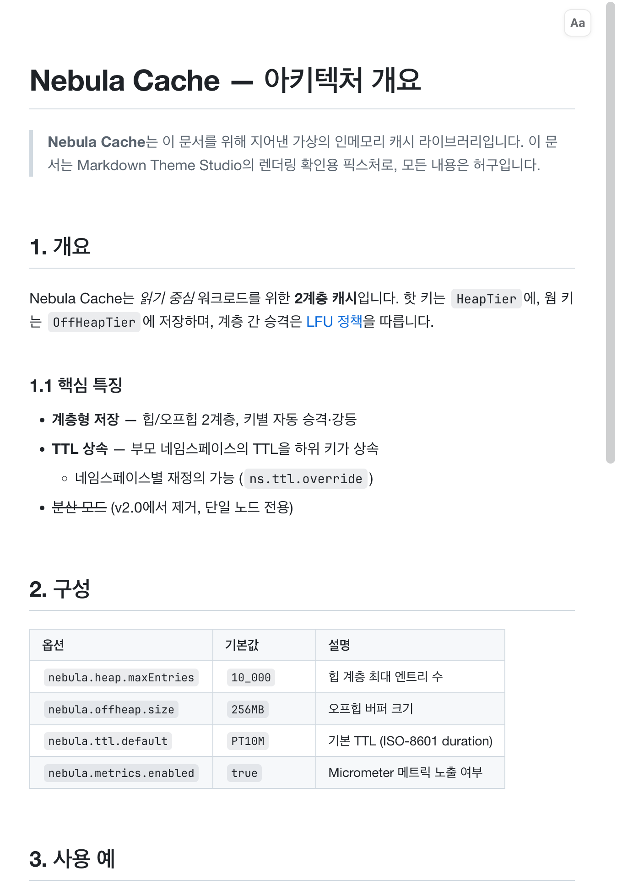
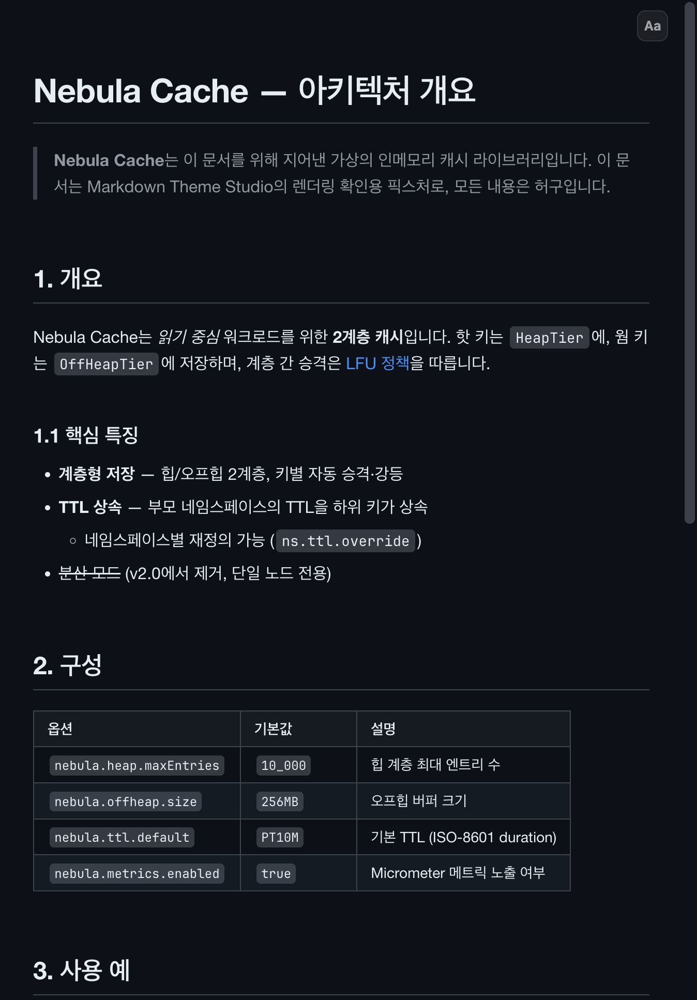
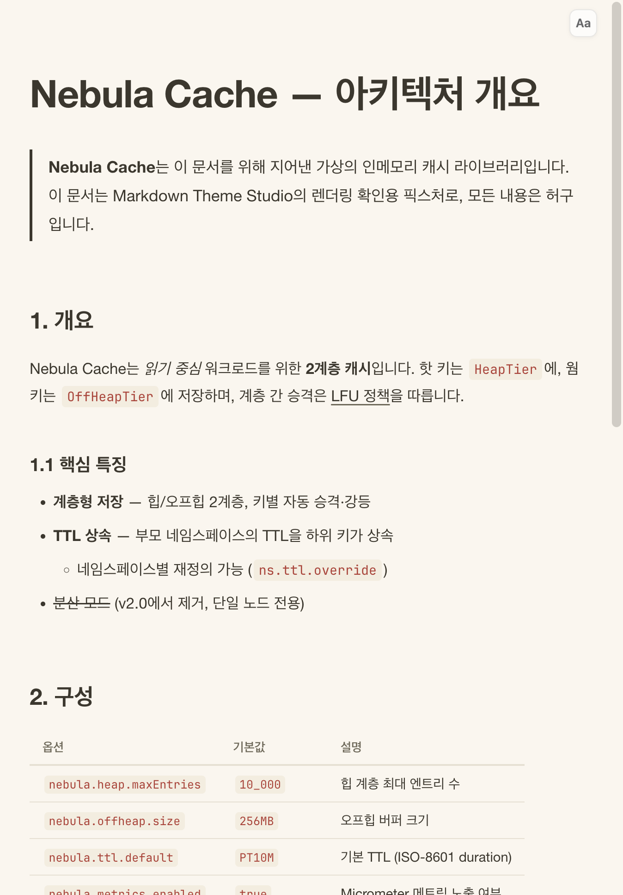
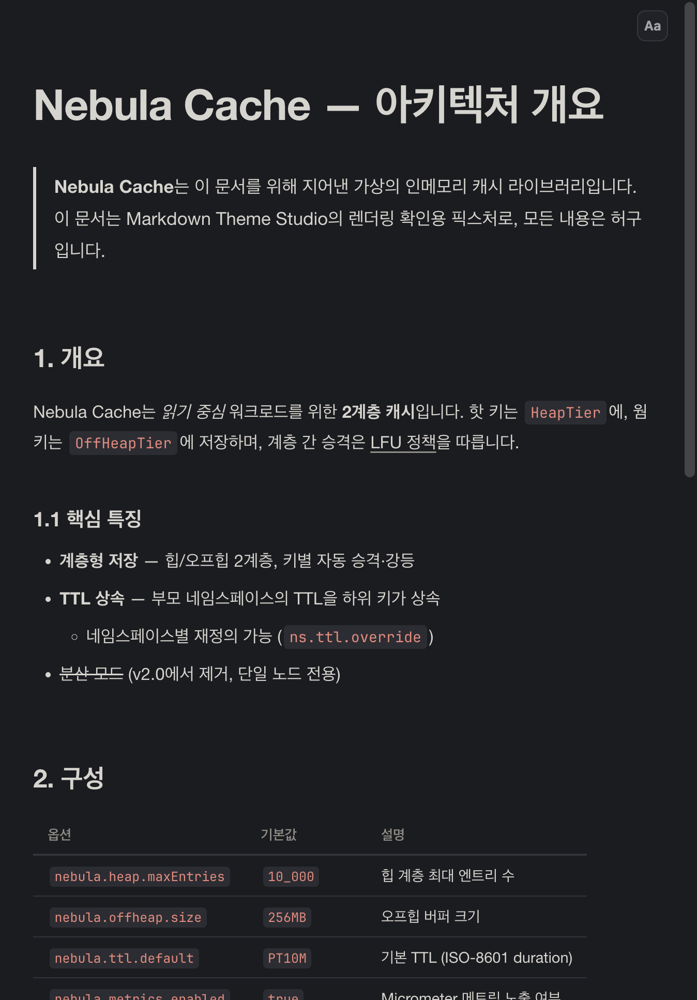
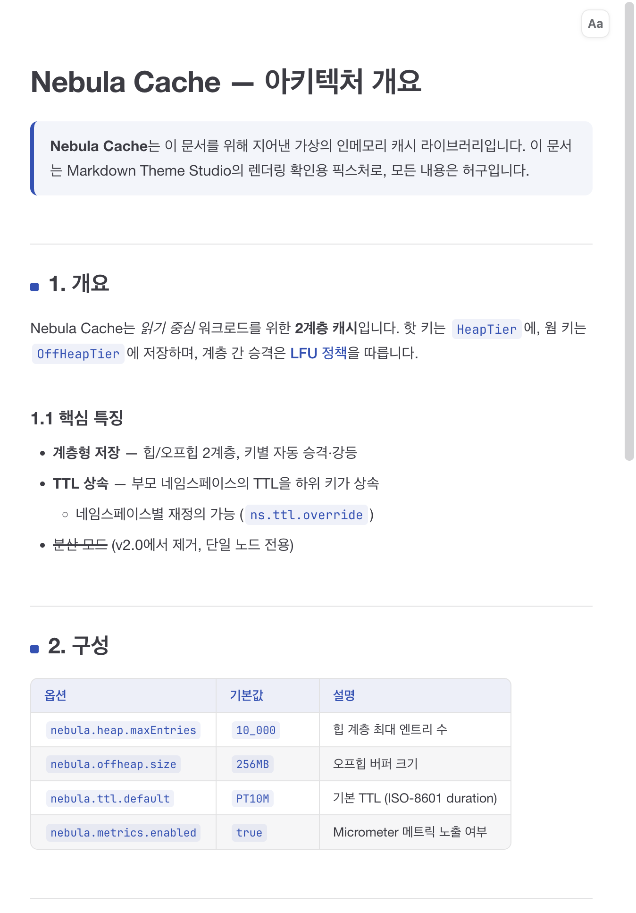
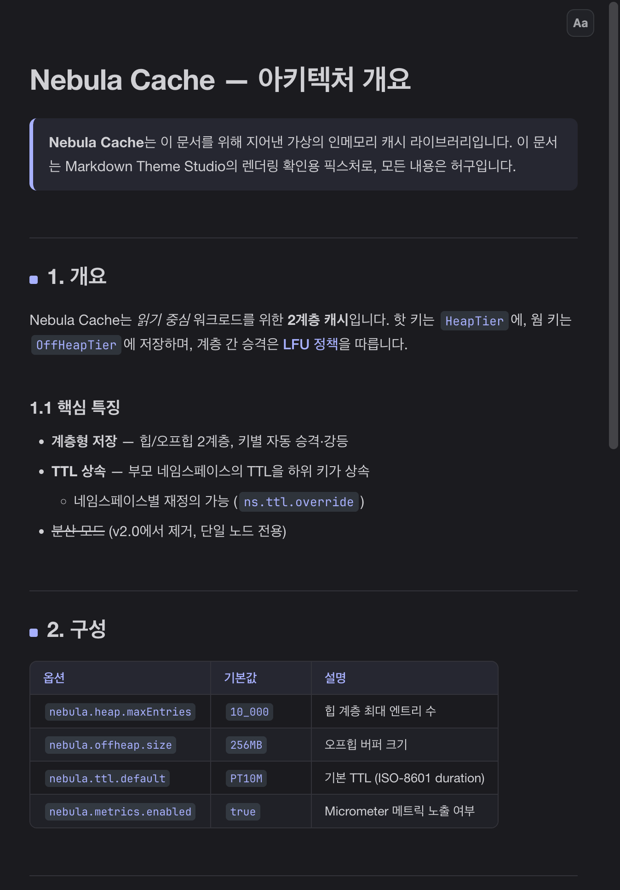
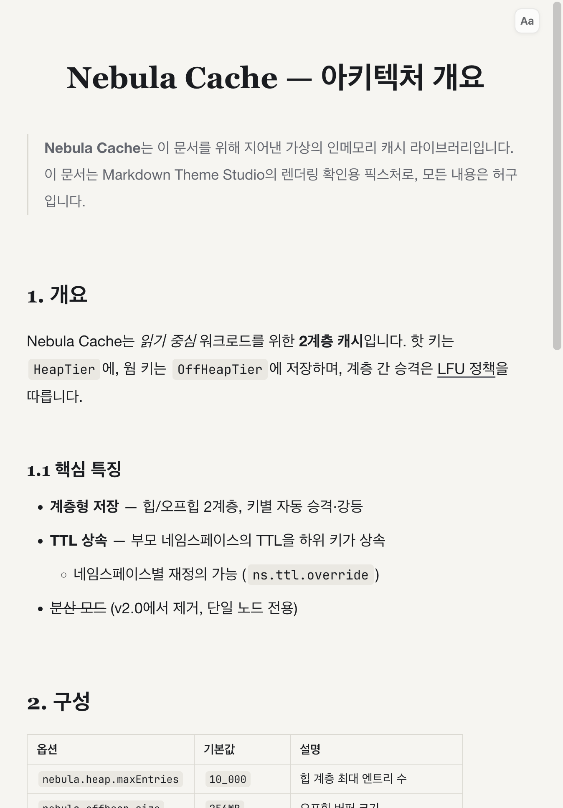
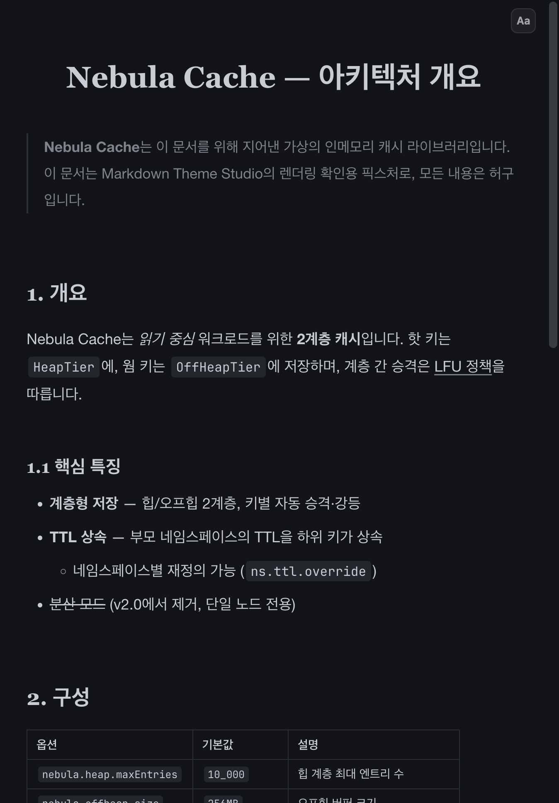
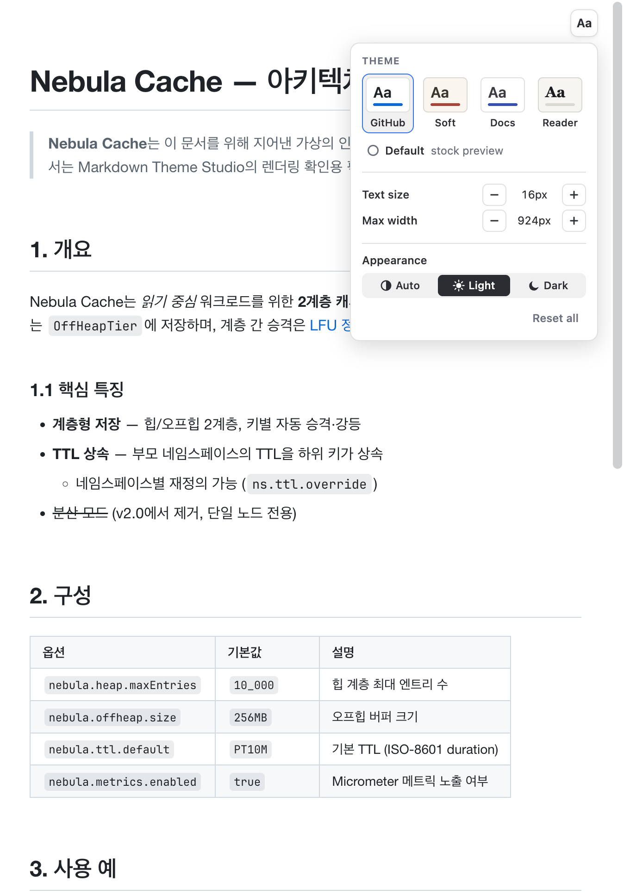
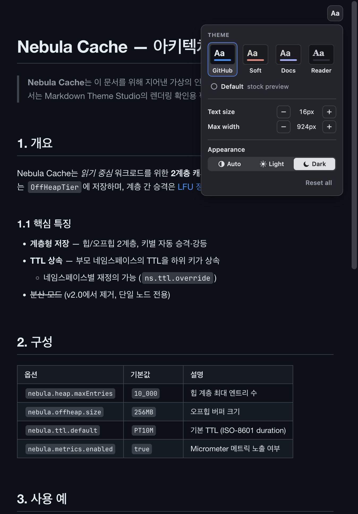

# Markdown Theme Studio

JetBrains IDE의 기본 Markdown preview 가독성을 개선하는 플러그인입니다. 번들 Markdown 플러그인의 렌더링 파이프라인(파싱, 싱크 스크롤, 코드 하이라이트)은 그대로 두고 스타일만 재정의합니다.

- **테마 4종 + Default** — 타이포그래피, 코드 블록, 표에 맞춰 다듬은 테마를 preview 우측 상단 **Aa** 메뉴에서 바로 전환. Default를 고르면 기본 preview 스타일로 복귀
- **글자 크기·본문 폭 조절** — 현재 값(px)을 보면서 단계 조절, Reset all로 한 번에 초기화
- **라이트/다크 자동 추종** — IDE 테마를 따라가며, 수동 고정(Auto / Light / Dark)도 가능
- **키보드로 전부 조작** — Enter로 열고, 방향키로 고르고, Esc로 닫는다
- **IDE 설정으로 저장·동기화** — 테마·외관·글자 크기·폭은 IDE 설정에 저장되어 모든 preview·프로젝트 창이 같은 값을 쓰고, Backup and Sync(Settings Sync)로 다른 IDE와 맞춰짐. Find Action의 **Switch Markdown Theme**으로도 전환
- **한국어 줄바꿈** — 한국어 문서는 어절 단위로 줄을 바꿔 단어 중간에서 끊기지 않음. 영어 위주 문서 안의 한국어 표도 셀이 어절 단위로 줄을 바꿔 열이 세로 띠로 눌리지 않음(다른 언어 글자는 기본 줄바꿈 그대로)
- **프로젝트 커스텀 CSS 위에서도 동작** — `.idea/markdown.xml`의 기존 커스텀 CSS(예: Typora 이식 스니펫)가 있어도 테마가 우선 적용
- **문서 안 HTML 인라인 스타일 존중** — 작성자가 HTML에 직접 단 정렬·테두리·여백·글꼴·크기 같은 인라인 스타일·속성은 그대로 유지. 글자색과 배경은 같은 요소에 둘 다(단색 불투명 배경으로) 지정했을 때만 유지하고, 테마가 다루는 요소(문단·제목·목록·표 등)는 한쪽만이면 테마 색을 써서 다크 외관에서도 읽힘

## 테마

| 테마 | 성격 |
|---|---|
| **GitHub** | GitHub 문서 스타일에 충실한 기본 테마 |
| **Soft** | 크림 톤 배경의 편안한 저대비 테마 |
| **Docs** | 인디고 포인트의 기술 문서 스타일 |
| **Reader** | serif 헤딩, 좁은 본문 폭의 긴 글 읽기용 테마 |

### 미리보기

| | 라이트 | 다크 |
|---|---|---|
| **GitHub** |  |  |
| **Soft** |  |  |
| **Docs** |  |  |
| **Reader** |  |  |

## 설치

지원 범위: **2025.1 이상** (IntelliJ IDEA·WebStorm·PyCharm 등 번들 Markdown 플러그인이 있는 JetBrains IDE). 새 IDE 버전은 매주 최신 릴리즈·EAP로 호환성을 자동 점검합니다

1. 플러그인 zip 빌드 (또는 배포된 zip 사용)

   ```
   ./gradlew buildPlugin
   ```

   → `build/distributions/markdown-theme-studio-<버전>.zip`

2. IDE에서 **Settings → Plugins → ⚙️ → Install Plugin from Disk…** 로 zip 선택

   대부분 재시작 없이 바로 설치됩니다(Plugin Verifier 판정: 재시작 없이 활성화·비활성화 가능). 다만 **이미 열려 있던 Markdown preview에는 적용되지 않으므로** 파일을 닫았다 다시 열어 주세요. preview가 열린 상태에서 업데이트·제거하면 IDE가 재시작을 요청할 수 있습니다.

## 사용법

Markdown preview 우측 상단의 **Aa** 버튼을 누르면 설정 패널이 열립니다.

| 라이트 | 다크 |
|---|---|
|  |  |

- **Theme** — 견본 카드(GitHub / Soft / Docs / Reader)를 눌러 전환. **Default**는 플러그인 스타일을 끄고 기본 preview로 되돌립니다
- **Text size / Max width** — − / + 로 본문 글자 크기(±3px)와 본문 최대 폭(±240px)을 조절. 가운데에 현재 값이 표시됩니다(preview 패널이 더 좁으면 실제 본문 폭은 패널에 맞춰 줄어듭니다)
- **Appearance** — Auto(IDE 테마 추종) / Light / Dark
- **Reset all** — GitHub 테마·Auto·기본 크기와 폭으로 초기화

키보드: Aa에 포커스 후 Enter/Space로 열고, 방향키로 항목 안에서 이동·선택, Tab으로 다음 항목, Esc로 닫습니다. 패널 밖을 클릭해도 닫힙니다.

### Find Action·단축키

**Find Action**(macOS ⇧⌘A, Windows/Linux Ctrl+Shift+A)에서 **Switch Markdown Theme**을 실행하면 테마 목록(GitHub / Soft / Docs / Reader / Default)이 뜹니다. 고른 테마는 열려 있는 preview 전부에 바로 반영됩니다. 자주 쓰면 **Settings → Keymap**에서 이 액션에 단축키를 지정하세요.

### 설정 저장과 IDE 간 동기화

테마·외관·글자 크기·폭은 IDE 설정(`options/markdownThemeStudio.xml`)에 저장됩니다. 한 preview에서 바꾸면 다른 preview·다른 프로젝트 창에도 바로 반영됩니다.

- **Backup and Sync(Settings Sync)** — **UI settings** 카테고리에 포함되어 동기화됩니다. IntelliJ IDEA·WebStorm·PyCharm처럼 **서로 다른 IDE 제품끼리** 맞추려면 Backup and Sync 설정의 **Sync settings across**를 전 제품(2025.2 이상 **JetBrains IDE products and Android Studio**, 2025.1 **All JetBrains IDE products**)으로 바꾸세요(기본값은 같은 제품의 다른 설치본끼리만 동기화). 받는 쪽 IDE에도 이 플러그인이 설치돼 있어야 합니다
- **이전 버전에서 업데이트** — preview에 저장돼 있던 기존 선택은 그 IDE에 아직 설정 값이 없으면 처음 preview를 열 때 IDE 설정으로 옮겨집니다. 이미 다른 IDE에서 동기화된 값이 있으면 그 값이 우선합니다. 예전 저장소는 IDE 내장 서버 포트(63342~)별이라, 여러 IDE를 동시에 띄워 포트가 바뀌었으면 옮길 값을 찾지 못할 수 있습니다 — 한 번 다시 고르면 그때부터는 IDE 설정에 남습니다

## 개발

```
./gradlew runIde        # IC 2025.1 샌드박스 실행
./gradlew buildPlugin   # 배포 zip 생성
./gradlew test          # 단위 테스트
./gradlew verifyPlugin  # 지원 IDE 범위 바이너리 호환성 검사
tools/build-zip.sh      # 배포 zip 빌드 + 패키징 검증 (테스트 포함)
```

구조:

- `ThemeStudioPreviewExtension.kt` — `browserPreviewExtensionProvider` 확장점 구현. CSS/JS를 preview에 서빙
- `themes/mts.css` — 테마 스타일. `html[data-mts-theme]` 스코프라 속성이 없으면 기본 preview 그대로
- `themes/mts.js` — 스위처 위젯과 테마/외관 상태 관리
- IDE 설정 동기화 — `ThemeStudioSettings.kt`(설정 원천, Settings Sync), `PreviewSettingsSync.kt`·`PipeHandler.java`·`themes/mts-ide.js`(preview↔IDE 통신), `PreviewPrefs.kt`·`PreviewProtocol.kt`(값 검증·메시지 형식), `SwitchThemeAction.kt`(Find Action)

자세한 아키텍처와 플랫폼 제약은 [CLAUDE.md](CLAUDE.md)를 참고하세요.

## 문제 해결

**테마가 보이지 않는다**

- **preview 렌더러가 Compose로 설정돼 있다** — 2025.2~2026.2에는 실험 기능인 Compose 렌더러를 고르는 옵션이 있습니다. 이 플러그인은 Chromium(JCEF) preview에 스타일을 입히는 방식이라 Compose 렌더러에서는 동작하지 않습니다. **Settings → Languages & Frameworks → Markdown → Preview rendering engine**을 **Chromium browser**로 바꾸세요. (Compose 렌더러에는 외부 스타일을 넣을 공식 경로가 없습니다 — [#26](https://github.com/sanggi-wjg/markdown-theme-studio/issues/26))
- **Default가 선택돼 있다** — preview 우측 상단 **Aa**에서 테마를 고르세요. Default는 플러그인 스타일을 끈 상태입니다.
- **설치 직후 이미 열려 있던 preview** — 파일을 다시 열면 적용됩니다.

**프로젝트에 커스텀 CSS가 있다**

`.idea/markdown.xml`의 커스텀 CSS(예: Typora 테마 이식 스니펫)가 있어도 테마가 우선합니다. 커스텀 CSS를 그대로 쓰고 싶으면 **Aa → Default**를 고르세요.

**문서 안 HTML에 단 스타일이 일부만 적용된다**

Markdown 안에 직접 쓴 HTML의 인라인 `style`·`align`·`border` 중 정렬·테두리·여백·크기·글꼴·줄 간격 같은 배치·조판 속성은 작성자 값을 따릅니다. 테마가 다루는 요소(문단·제목·목록·표·인용·코드 등)의 글자색과 배경은 **같은 요소에 둘 다**(단색 불투명 배경으로) 지정했을 때만 작성자 값을 쓰고, 한쪽만 지정했거나 배경이 투명·반투명·그라데이션이면 테마 색을 씁니다 — 라이트 배경을 전제로 고른 색이 다크 외관에서 안 보이게 되는 것을 막기 위해서입니다. 테마를 거치지 않은 원래 스타일을 보려면 **Aa → Default**를 고르세요. 프로젝트 커스텀 CSS가 같은 요소의 같은 속성을 `!important`로 지정했다면 작성자 값 대신 커스텀 CSS 값이 적용됩니다(Default에서도 같음). `span`·`div`처럼 테마가 다루지 않는 요소에 단 색은 한쪽만 지정해도 그대로 적용되므로, 다크 외관에서 읽기 어려우면 글자색과 배경을 함께 지정하세요.

**다른 IDE와 설정이 맞춰지지 않는다**

- Backup and Sync가 켜져 있고 **UI settings** 카테고리가 포함돼 있는지 확인하세요
- 제품이 다르면(IDEA↔PyCharm 등) **Sync settings across**를 전 제품(2025.2+ **JetBrains IDE products and Android Studio**, 2025.1 **All JetBrains IDE products**)으로 골라야 합니다
- 동기화로 값이 들어오면 열린 preview에도 바로 반영됩니다. 반영되지 않는 preview는 파일을 다시 열면 맞춰집니다

**IDE 설정 연동이 동작하지 않는 환경**

preview와 IDE 사이 통신 경로(번들 Markdown 플러그인의 실험적 API)를 쓸 수 없는 IDE 버전에서는 이전처럼 preview 내부 저장소(localStorage)에만 저장됩니다. 위젯은 그대로 동작하지만 IDE 간 동기화와 preview 사이 즉시 반영은 되지 않습니다.

## 라이선스

[MIT](LICENSE)
