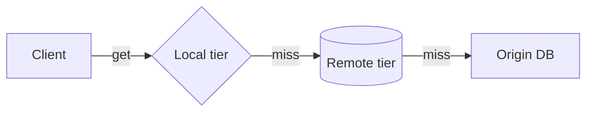

# Element Zoo — h1

> 마크다운 전 요소 커버리지 픽스처입니다. 마커: `mts-elements-fixture`
> 모든 내용은 [sample.md](sample.md)와 같은 가상의 Nebula Cache 프로젝트 문서다.

## 인라인 전종 — h2

일반 본문에 **굵게**, *기울임*, ~~취소선~~, `인라인 코드`, [링크](https://example.com/nebula), <ins>삽입</ins>, <mark>하이라이트</mark>, <kbd>Cmd</kbd>+<kbd>K</kbd>, 위첨자<sup>2</sup>, 아래첨자<sub>i</sub>, <u>밑줄</u>, <small>스몰 텍스트</small>가 섞여 있다.

오토링크: https://example.com/grafana/d/nebula-cache-overview?orgId=1&refresh=30s

### 목록 — h3

- 1단계 항목
  - 2단계 항목
    - 3단계 항목 — `코드`와 **강조** 포함
- [x] 완료된 작업
- [ ] 미완료 작업 (체크박스 렌더 확인)

1. 순서 목록
2. 둘째
   1. 중첩 순서

#### 인용 — h4

> 1단계 인용에 `인라인 코드`와 [링크](https://example.com)가 있다.
>
> > 2단계 중첩 인용.
>
> - 인용 안 목록

##### 코드 — h5

```kotlin
val cache = NebulaCache.builder().namespace("catalog").build()  // 펜스 코드
```

    val indented = "들여쓰기 코드 블록"  // 펜스 아닌 pre

###### 표·이미지·수평선 — h6

| 키 | 값 |
|---|---|
| 모드 | 단일 |


---

용어 정의 시도 (지원 여부 확인용)
: 정의 목록이 파서에서 지원되면 dl/dt/dd로 렌더된다.

각주 시도[^1]

[^1]: 각주가 지원되면 별도 섹션으로 렌더된다.

## GitHub Alert — 2026.2+ 번들 렌더 (이전 버전은 일반 인용으로 보인다)

> [!NOTE]
> 노트 알림 — 캐시 TTL 기본값은 `300s`다. [문서 링크](https://example.com/nebula/ttl)

> [!TIP]
> 팁 알림 — 핫 키는 **로컬 티어**에 고정하면 p99가 줄어든다.

> [!IMPORTANT]
> 중요 알림 — 네임스페이스 이름은 배포 후 변경할 수 없다.

> [!WARNING]
> 경고 알림 — `evictAll()`은 클러스터 전체에 전파된다.
>
> 두 번째 문단과 목록:
> - 롤링 재시작 중에는 호출 금지

> [!CAUTION]
> 주의 알림 — 운영 환경에서 `--force` 플래그를 쓰지 말 것.

## 수식 — 번들 MathJax 렌더 (2025.1+)

인라인 수식 $E = mc^2$ 과 적중률 $h = \frac{hits}{hits + misses}$ 이 본문에 섞여 있다.

$$
T_{eff} = h \cdot T_{cache} + (1 - h) \cdot T_{origin}
$$

수식이 들어간 표 셀과 긴 수식(좁은 패널 가로 스크롤 확인):

| 지표 | 정의 |
|---|---|
| 적중률 | $h = \frac{hits}{hits + misses}$ |

$$
L = \sum_{i=1}^{n} w_i \cdot latency_i + \sum_{j=1}^{m} penalty_j \cdot \left( \frac{evictions_j}{capacity_j} \right)^2 \le SLO_{p99}
$$

## Mermaid — 번들/플러그인 렌더 (테마가 다이어그램을 깨뜨리지 않는지 확인)


