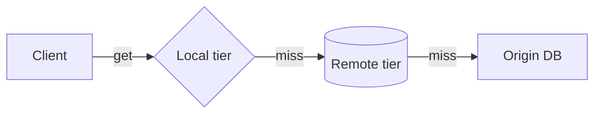
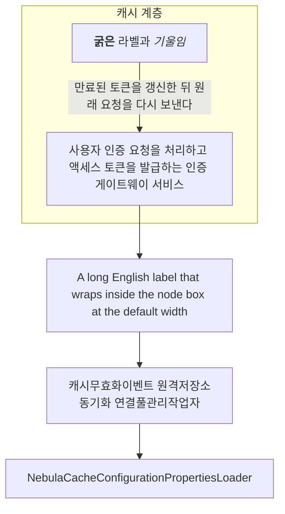
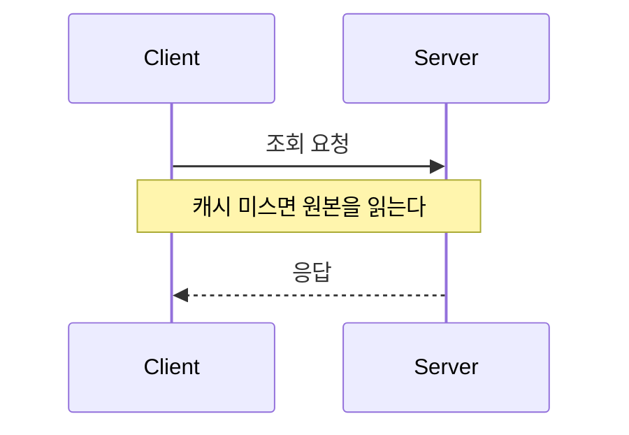
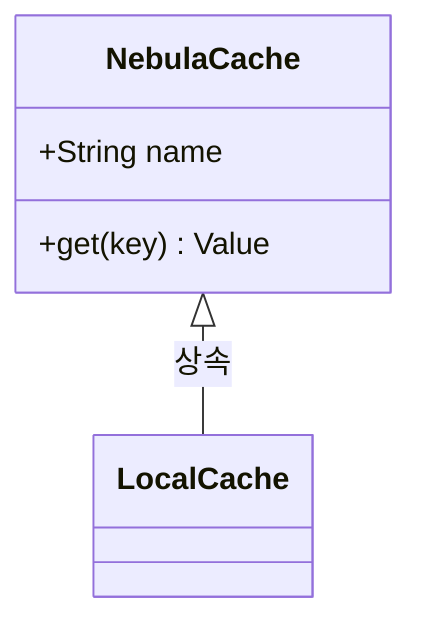
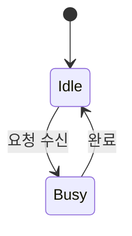
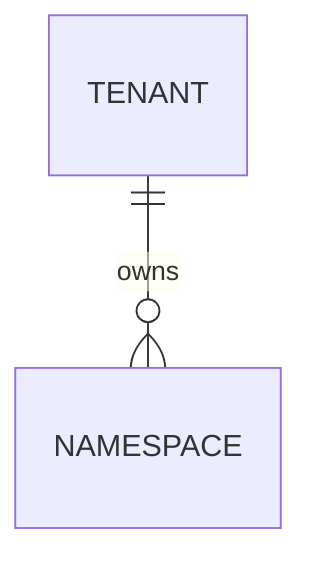
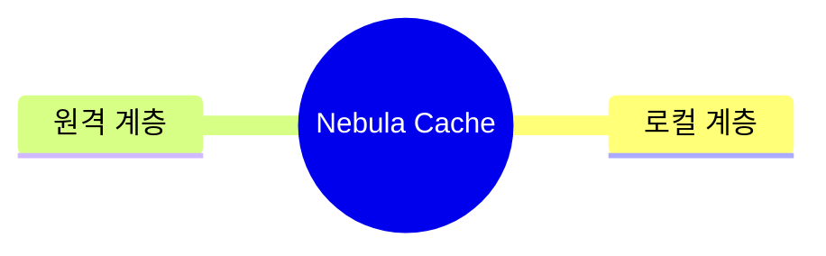

# Mermaid Labels — 라벨 박스 픽스처

Mermaid는 노드·간선 라벨을 SVG `foreignObject` 안의 HTML(`div > span > p`)로 그리고, 렌더할 때 잰 라벨 크기로 노드와 간선 배치를 정한다. 테마 규칙이 라벨 박스를 바꾸면 그 배치와 어긋난다(#59). 모든 다이어그램의 라벨 박스는 테마 off와 같아야 한다. 마커: `mts-mermaid-fixture`

## Flowchart — 노드·간선 라벨

## 서브그래프·마크다운 문자열·긴 라벨

## Sequence

## Class

## State

## ER

## Mindmap

